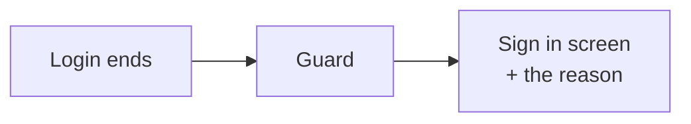
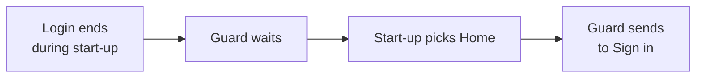
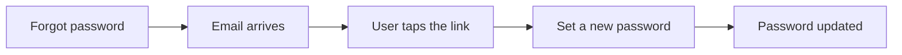

# When the login ends, and when the user forgets their password

This page explains two things the app has to react to, from any screen:

1. **The login ends by itself.** The user did not tap "Sign out". Their login just stopped working.
2. **The user opens the reset-password link** from their email.

You do not need to know the code to follow it. A short "where is the code" list is at the end.

---

## The big idea

Both things can happen **at any moment, on any screen**, even before the first screen has appeared.
So no single screen handles them. Two small helpers watch for them for the whole app:

| Helper | In one sentence |
|---|---|
| **Session guard** | If the login ends, take the user to the Sign in screen and tell them why. |
| **Recovery link handler** | If the reset link is opened, show the "set a new password" screen. |

---

## Part 1: The login ends by itself

### Why it can happen

| Reason shown to the user | What it means |
|---|---|
| **Expired** | The login ran out of time. |
| **Revoked** | The login was ended somewhere else (another phone, or the password was changed). |

Whichever way the app finds out, it ends the same way:

### What the guard does

When the login ends, the guard looks at the screen the user is on:

| The user is on | The guard |
|---|---|
| The start-up screen | Waits (see "Start-up" below) |
| Sign in, Sign up, Reset password, Onboarding | Does nothing |
| Any other screen | Goes to Sign in and shows why |

Why the user is left alone on some screens:

- **Sign in:** already where we would send them.
- **Sign up and Reset password:** they are typing. Do not throw their input away.
- **Onboarding:** nothing to protect yet.
- **Start-up screen:** it decides where to go by itself (see next).

Going to Sign in **removes every screen behind it**, so "Back" cannot return to a screen that needs a login.

### Start-up: the one tricky case

The start-up screen (splash) decides the first real screen, for example Home. If the login ends **while it is still deciding**, the guard must not jump in and compete with it. So the guard **remembers** the problem, then checks the screen the splash picks:

If the splash picks Sign in, Sign up, or Reset password, the guard forgets the problem. Those screens already handle it.

### What the user sees

The Sign in screen opens with the saved account and a short message: "your session expired" or "your session was ended on another device".

---

## Part 2: The reset-password link

### The normal path

### Two outcomes when the link opens

| What happened | What the user sees |
|---|---|
| **The link works** | The "Set a new password" screen opens. |
| **The link is old or already used** | They stay where they are and see a small message: the link no longer works. |

### The app remembers an unfinished reset

If the user opens the link and then **closes the app** before choosing a password, the app remembers.
Next time it opens, it goes straight back to "Set a new password". It forgets the reset when:

- the password is changed, or
- the user signs in, or signs out, or the reset login is gone.

### Opening the app from the link (cold start)

When the app was closed, the link starts it. At that moment no screen exists yet, so the helper waits one moment and then acts.
The start-up screen also knows about the unfinished reset. Either way, the user ends up on "Set a new password".

### Leaving the reset screen

| User does | Result |
|---|---|
| Saves a new password | "Password updated" message. They can also sign out their other devices. |
| Taps X, or "Sign in" | The reset login is ended on this phone, then Sign in opens. |

---

## Known gaps (not done yet)

| Gap | What happens today |
|---|---|
| A request fails because the login **expired**, but the login service did not announce it | The screen shows its own error. The guard does not move the user. Only "revoked" is reported this way, because other "expired" errors can be something else, like a permission problem. |
| The login ends while the user is on **Sign up** | They stay on the form and find out when they submit. |
| The login ends while the user is on **Reset password** | Same: they find out when they submit. |
| The reset link is **old** | Only a small message appears. There is no button to ask for a new link. |
| The guard or link opens a new screen | Everything behind it is removed, so unsaved input on other screens is lost. |

---

## Where is the code

| Part | File |
|---|---|
| Session guard | `lib/core/router/session_guard.dart` |
| Recovery link handler | `lib/core/router/recovery_link_handler.dart` |
| "Revoked" announcement | `lib/core/services/session_events.dart` |
| Remembers an unfinished reset | `lib/features/auth/data/datasource/password_recovery_tracker.dart` |
| Where they are created | `lib/app/app_module.dart` |
| Tests | `test/core/router/session_guard_test.dart`, `test/core/router/recovery_link_handler_test.dart` |

Related screens: [Splash](screens/s13-splash.md), [Sign in after sign-out](screens/s14-signin-signed-out.md),
[Set new password](screens/s11-set-new-password.md).
